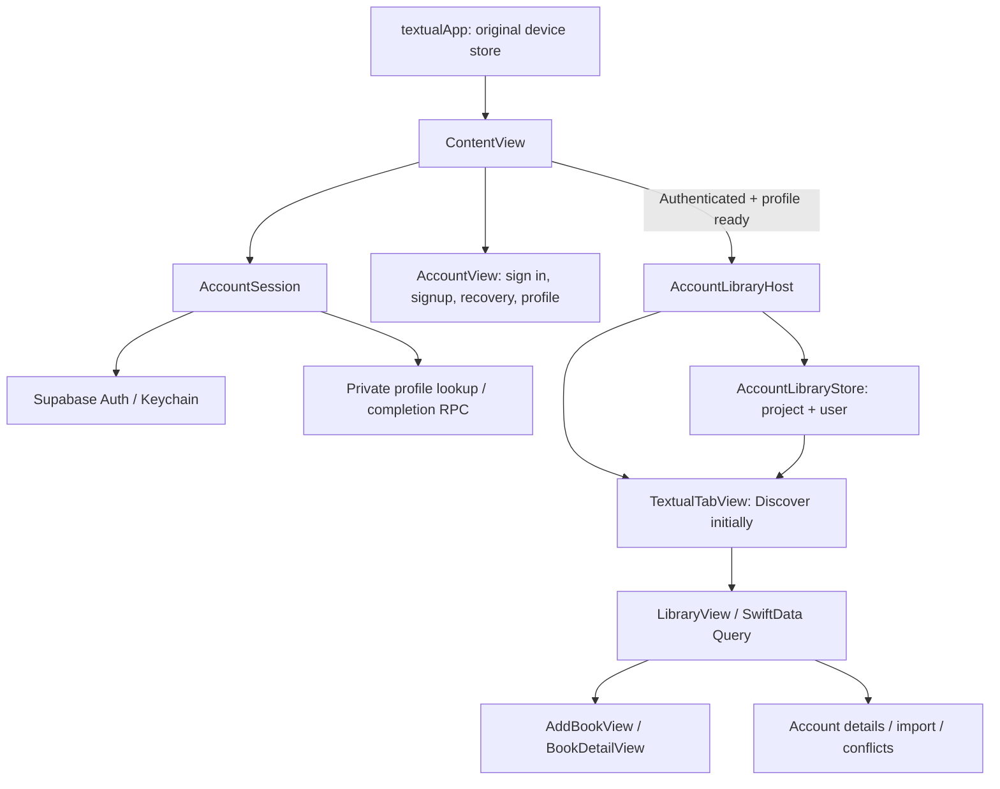
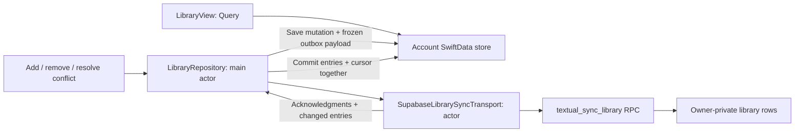

# Textual — Architecture

The app gates an account-specific SwiftData library behind Supabase Auth and a completed private profile. Catalog search remains a direct Google Books/Open Library integration.

## App and account flow



`textualApp` retains the original Book/Tag container as the source for an optional import. `ContentView` owns one observable `AccountSession`, runs its long-lived auth observer outside the signed-in/out branches, and forwards `.onOpenURL` callbacks.

`AccountSession` owns authentication and profile state on the main actor. Supabase's Swift SDK handles Keychain-backed credentials. Signup supplies the intended first name/username as untrusted metadata, then waits for email confirmation. New confirmation and recovery emails display a code; the user can read the email on any device and enter the code in Textual. `verifyEmailCode(email:code:purpose:)` validates the code locally before calling Supabase with the matching signup or recovery type. A verified recovery session requires a new password before entering the library, with a non-secret per-user recovery marker surviving a relaunch.

Legacy PKCE email callbacks remain supported at `textual://auth/callback` and `textual://auth/recovery`; `Info.plist` registers the `textual` scheme. These links are compatibility paths, not the default in new confirmation/recovery email templates. Email/password sign-in remains available to already-confirmed accounts.

After an account identity changes, profile state is cleared and a filtered own-row request reads `textual_profiles`. The service distinguishes loading, known missing, and failed lookup. Missing profiles require explicit completion through `textual_upsert_profile`; suggestions never automatically overwrite an existing profile. Usernames are normalized to lowercase ASCII letters/digits/underscores, 3–30 characters, with database-enforced uniqueness. The first name is trimmed, 1–80 characters, without control characters.

Every profile response checks both its request generation and active account. Profile writes also include an expected-user assertion checked against `auth.uid()` by the RPC. Refresh events reuse the loaded profile without extra requests or loading flicker. Profiles are currently memory-only, so a cold start needs a successful lookup before the library opens.

`AccountView` handles the staged signup/sign-in forms, validation, code entry, recovery, profile completion, retry, and account details. A signed-out user can enter an existing confirmation code from the sign-in email screen or an existing recovery code from the forgot-password screen. Opening either route or navigating Back does not send email; resend is explicit. Back retains the email draft and clears the code. Codes remain in transient view state. `ContentView` opens the signed-in tabs only when restoration/profile work is complete, a profile exists, and password recovery is finished. Apple Sign-In remains planned. Friendships, Community, and visitor profiles are described in [docs/social-architecture.md](docs/social-architecture.md).

## Account-local storage

`AccountLibraryStore` creates a SwiftData schema containing `Book`, `Tag`, and `LibrarySyncState`. Its persistent file is:

```
Application Support/Accounts/<supabase-project-host>/<user-uuid>/library.store
```

`TextualTabView` sits inside the store-ready branch of `AccountLibraryHost`. It uses a native `TabView` with stable tagged children and hidden system tab chrome, plus an overlaid icon-only capsule. The capsule uses 24-point physical bottom and side margins; only the container’s bottom safe area is ignored, preserving keyboard avoidance. Selection starts at The Archive (`home`, rendered by `DiscoverView`) once per account-scoped shell. Tab switches retain the store, repository, and My Archive (`library`) state. LibraryView owns its compact header and decorative top/bottom gradients, so books scroll beneath the controls without a large-title gap or inward viewport mask. Its content padding includes the shared navigation extent and measured sync-banner height; Retry/Review stay above the capsule. Account settings and explicit legacy import live in Menu. The other page features remain deferred as listed in README.

`AccountLibraryHost` is keyed by user ID. On disappearance/account change it stops the repository and releases its container; signing out preserves local data but removes it from the visible account. The original device store is never silently attached to a newly signed-in user.

Import requires explicit confirmation. It copies the original device's books into the chosen account, preserves source data, resolves missing catalog references where possible, and records completion once per project/device. It does not import or sync custom shelves/tags. An interrupted import can be retried; additions deduplicate by catalog identity.

## Library data and synchronization



`LibraryRepository` owns a single account/model context and coalesces concurrent synchronization requests. SwiftData reads and mutations stay on the main actor; `SupabaseLibrarySyncTransport` performs HTTP/response decoding on a separate actor. Network requests use immutable Codable DTOs, not SwiftData objects.

A local mutation stores a new operation UUID and the exact JSON payload before sending. The server acknowledges it idempotently; the client only clears the operation it submitted, preserving newer edits made during a request. Each batch contains at most 50 changes and pulls at most 200 entries. A foreground run makes at most five requests; remaining work stays queued.

The server controls revisions and compares each change's expected revision. Conflicts persist the remote snapshot beside the local edit and pause automatic resubmission until the user chooses the local or synced version. Deletions use tombstones. `Book.id` remains stable if concurrent additions resolve to a different canonical server entry ID.

The pull cursor lives in `LibrarySyncState` and is saved in the same transaction as downloaded changes. Failed local saves cannot advance it. Repository generation checks discard stale responses after stop/account change. The transport checks the current session; the RPC independently compares `p_expected_user_id` with `auth.uid()` to catch a token/account change at request dispatch.

Sync runs on library opening, supported mutations, foregrounding, network recovery, and manual retry. Offline edits remain in the local outbox. This is foreground synchronization; iOS background scheduling is not implemented. A warm library can remain useful offline, but cold-start access is currently gated by profile loading.

## Backend boundary

| Object | Responsibility |
|---|---|
| `auth.users` | Supabase identity and confirmation; profile fields are not trusted from metadata. |
| `textual_profiles` | Owner-private first name and globally unique normalized username. |
| `textual_books` | Shared provider/source identity only; client-supplied metadata cannot poison shared catalog content. |
| `textual_library_entries` | Owner-private book membership, title/author/ISBN/cover snapshot, revision, and tombstone. |
| `textual_upsert_profile` | Atomic profile save/username claim with authenticated ownership assertion. |
| `textual_sync_library` | Account-bound batch writes, idempotency, conflict results, and revision-based pulls. |
| `textual_discovery_*` | Shared Discover collections from public providers only; read through `textual_read_discovery`, written only by the service-role `discovery-refresh` function. See `docs/discovery.md`. |
| `textual_friendships`, `textual_activity` | One row per reader pair; one reference row per verified, shared action. RLS on, no client grants; read through narrow social RPCs (`textual_read_feed`, `textual_read_public_profile`, …). See `docs/social-architecture.md`. |

RLS limits private row reads to their owner. Validating security-definer RPCs are the authenticated write interface. The current library protocol does not include ratings, reading status, notes, tags, or social activity.

Only the Supabase URL and a public publishable/anon key belong in the iPhone configuration. Service-role/secret keys, SMTP credentials, and database passwords stay outside the client. `Secrets` rejects missing/placeholder configuration and privileged Supabase key types; RLS remains the authorization boundary.

Email transport is configured separately in Supabase. The source templates are `supabase/templates/confirmation.html` (subject: **Confirm your Textual email**) and `supabase/templates/recovery.html` (subject: **Reset your Textual password**). Both use `{{ .Token }}` to display the code entered in the app; they do not direct new emails through `{{ .ConfirmationURL }}` links. Both callback URLs remain allowlisted for older link-based emails. Live delivery and successful verification of the new signup and recovery codes remain pending end-to-end checks.

## Catalog and image caching


`BookCatalogService.shared` coordinates Google Books (when configured) and Open Library. It owns request cancellation-aware rate limiting, bounded 64-entry caches (five-minute search pages; 24-hour details), an HTTP cache, and a temporary Google failure cooldown. Pagination pins the provider used by the first page. Search pages contain only row metadata; detail descriptions are fetched on demand and persisted on the Book model.

`BookCoverImage` uses one Nuke pipeline with bounded memory caching, a 100 MB disk cache, downsampling, and view-lifecycle request cancellation. Library data remains in SwiftData; transient search pages are cached only for the running process.

The prepared catalog cache/Edge Function is not deployed or wired into the iPhone client. `BookCatalogService.shared` still calls the external providers directly. Supabase account/library requests and catalog requests have separate responsibilities; syncing a library does not proxy its searches.

## Source map

| Area | Files under `textual/` |
|---|---|
| Entry/root | `textualApp.swift`, `ContentView.swift` |
| Account/profile | `Services/AccountSession.swift`, `Views/AccountView.swift` |
| Account stores/import/conflicts | `Views/AccountLibraryHost.swift` |
| Sync repository/transport/DTOs | `Services/LibraryRepository.swift` |
| Library/search/details | `Views/LibraryView.swift`, `Views/AddBookView.swift`, `Views/BookDetailView.swift` |
| Discover (The Archive tab) | `Views/DiscoverView.swift`, `Views/MasonryGrid.swift`, `Services/Discovery*.swift`; backend in `supabase/functions/discovery-refresh` and `supabase/migrations/009_discovery.sql` |
| Community, friends, visitor profiles | `Views/CommunityView.swift`, `Views/PublicReaderProfileView.swift`, `Views/SocialPrivacySettingsView.swift`, `Services/Social*.swift`; backend in `supabase/migrations/011_social_graph.sql` and `012_social_activity.sql` |
| Catalog view models | `ViewModels/AddBookViewModel.swift`, `ViewModels/BookDetailViewModel.swift` |
| Catalog service | `Services/BookCatalogService.swift` |
| Local models | `BookModel.swift`, `TagModel.swift`, `LibrarySyncState.swift` |
| Configuration/design | `Secrets.swift`, `Info.plist`, `DesignSystem/*` |

The `textualTests` target uses intercepted network fixtures for Auth code verification/recovery, profiles, and catalog tests, plus controlled sync transport tests. Bundled font tests verify the actual UIKit font registrations. `TextualAuthUITests` exercises signed-out navigation, retained drafts, keyboard layout, the existing-code routes, and local invalid-code rejection without sending email or submitting valid codes. Mocked and local tests do not substitute for the pending live email/code checks.

The search screen uses a single capsule-shaped field with the general catalog query. Author names and titles share the same provider search, caching, and pagination; no category selection or separate classification request is required.


## StoryGraph CSV import

`StoryGraphImporter` reads security-scoped UTF-8 CSV off the main actor and preserves
all original fields alongside typed reading metadata. `StoryGraphImportView` previews
matches without mutation; explicit confirmation calls `LibraryRepository.importStoryGraph`.
The repository checks the authenticated account and store checkpoint, recomputes matches,
and saves the entire local import plus durable outbox payloads in one transaction.
Stable edition identities and unchanged-data checks make retries safe. Conflicting
matches are rejected before writing. Covers resolve by ISBN without a catalog lookup
for every row. Personal metadata lives in `Book.storyGraphData` and the owner-private
`textual_library_entries.reading_data` column. The shared catalog receives identifiers
only. Existing RLS, account assertions, revision ordering, conflict handling and sync
retries apply. Old clients omitting reading metadata preserve it on the server.
