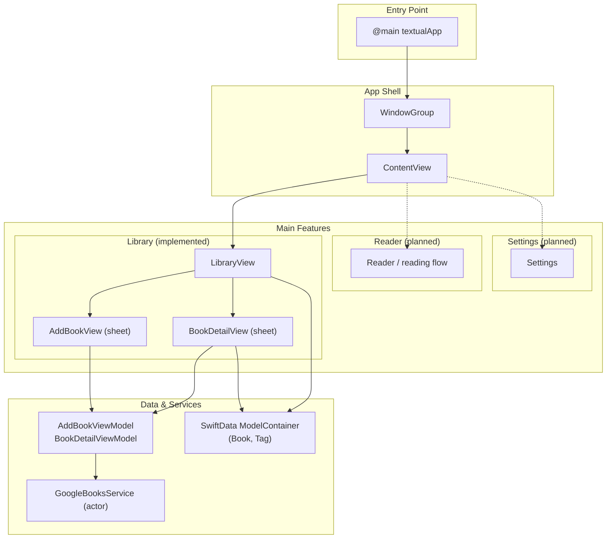
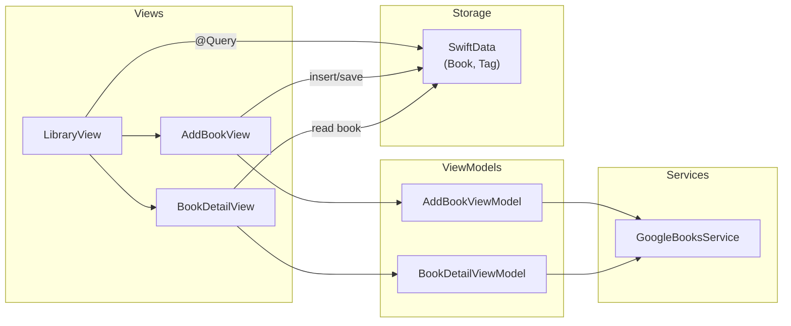

# Textual — High-Level Architecture

This document describes the app’s architecture from the entry point through the main feature areas: **Library**, **Reader**, and **Settings**.

## Architecture Overview

## Flow Description

| Layer | Component | Role |
|-------|-----------|------|
| **Entry** | `textualApp` | `@main` app; creates SwiftData `ModelContainer` (Book, Tag), configures nav bar and fonts, sets root to `ContentView`. |
| **App shell** | `ContentView` | Root view; currently presents **Library** only (no tab bar yet). |
| **Library** | `LibraryView` | Grid of books from `@Query`; “+” opens **Add Book**; tapping a book opens **Book Detail**. |
| **Add Book** | `AddBookView` | Search UI; uses `AddBookViewModel` → `GoogleBooksService`; saves chosen result as `Book` into SwiftData. |
| **Book Detail** | `BookDetailView` | Shows metadata/description; uses `BookDetailViewModel` to fetch volume via `GoogleBooksService`; loading/error/fallback states. |
| **Reader** | *(planned)* | Reading experience and status (Currently Reading, To Be Read, Read, DNF) per TECHNICAL_SPEC. |
| **Settings** | *(planned)* | App preferences and account; gated by Auth (Email/Apple) per spec. |

## Data Flow (Library)

## File Map (Source: `textual/`)

| Area | Files |
|------|--------|
| Entry | `textualApp.swift` |
| Root | `ContentView.swift` |
| Library | `Views/LibraryView.swift` |
| Add Book | `Views/AddBookView.swift` |
| Book Detail | `Views/BookDetailView.swift` |
| ViewModels | `ViewModels/AddBookViewModel.swift`, `ViewModels/BookDetailViewModel.swift` |
| Services | `Services/GoogleBooksService.swift` |
| Models | `BookModel.swift`, `TagModel.swift` |
| Design | `DesignSystem/*` |

Reader and Settings are specified in TECHNICAL_SPEC.md and will plug into the same app shell (e.g. via tabs or navigation) once implemented.
