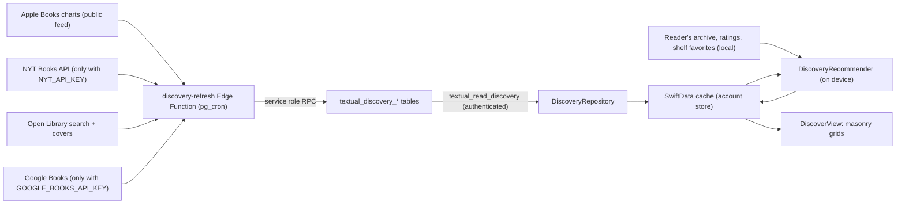

# Discover (The Archive tab)

The Archive tab is Discover: four tabs (**For You · Trending · Explore · Friends**), each a
continuous two-column grid of book covers with no titles, ratings, labels, or rankings.
Tap opens the existing `BookDetailView`; press, hold, slide, and release uses the existing
`HoldSlideSource` menu. The design reference is a Pinterest/Cosmos-style visual archive.



## Data sources

| Source | Used for | Status | Notes |
|---|---|---|---|
| Open Library search + covers | Catalog identity, Explore pools, new releases, chart resolution | On, no key | ≈1 request/second, identified User-Agent, covers by cover ID |
| Apple Books charts (`rss.marketingtools.apple.com`, top paid + top free, US) | Trending | On, no key | Public marketing feed. No published usage terms were found beyond Apple's marketing guidelines; only rank order is used. Apple artwork and links are not shown. Review before a commercial launch. |
| NYT Books API (`lists/overview`) | Trending | **Off** until `NYT_API_KEY` is set | See "NYT terms" below |
| Google Books | Resolving chart books Open Library hasn't catalogued | Off until a server `GOOGLE_BOOKS_API_KEY` is set | The app's key is iOS-restricted and can't be used server-side; keyless quota is shared and usually exhausted |

Nothing is ever invented. A chart row that can't be matched to a real catalog work with
a usable cover is left out, and a provider outage keeps the previous collection.

### NYT terms (checked October 12, 2026)

The NYT developer terms allow **non-commercial use only**. Their FAQ counts any app that is
paid or has a paid tier, now or in the future, as commercial. The terms also prohibit using
the API "to develop a software product". Separately, NYT content may not be cached for more
than 24 hours, and every screen showing NYT data must carry their logo or the text
"Data provided by The New York Times". The integration is fully built but stays off until
someone with authority to accept those terms adds the key. When it's on:

- Trending refreshes every six hours, and NYT-only rows carry a 24-hour expiry that
  both the read RPC and the app enforce, so stale NYT data disappears even if refreshes fail.
- The Trending grid shows "Data provided by The New York Times" (linking to
  developer.nytimes.com) whenever an NYT-sourced book is visible.
- Covers come from Open Library or Google, never NYT's `book_image`, and no NYT text or links are shown.

## Backend (`supabase/migrations/009_discovery.sql`)

| Object | Purpose |
|---|---|
| `textual_discovery_books` | Catalog snapshot per shared `textual_books` identity: title, author, ISBNs, cover URL, **measured cover width/height**, first-publication year, subjects, work key, Open Library reader count |
| `textual_discovery_collections` | `trending`, `new_releases`, and one `explore:<facet>` per subject/era/origin pool; refresh time, optional expiry, attribution |
| `textual_discovery_entries` | Collection membership, position, original provider rank, provenance (`apple`, `nyt`), per-row expiry |
| `textual_discovery_resolutions` | Chart row → catalog work cache (misses retried weekly) |
| `textual_read_discovery(collection, offset, limit)` | The only client endpoint. Requires a signed-in user; hides expired rows; `explore` merges all facet pools |
| `textual_apply_discovery_collection(jsonb)` | Service role only. Validates every row and replaces a collection atomically |
| `textual_discovery_token_valid(text)` | Service role only. Checks the scheduler token held in Vault |
| `textual_discovery_health()` | Operator check (SQL Editor): per-collection last refresh, book count, expired rows, and `stale` after two missed refreshes |

`010_discovery_service_grants.sql` grants the service role read access to the Discover tables
(and insert/update on chart resolutions). Projects with restricted default privileges don't
give it access to new tables automatically. No existing table's grants change.

RLS is enabled with no client grants or policies on the tables. Every row comes from
public providers through the service-role function, so the read endpoint cannot expose
private archive data. Saving a discovered book goes through the existing
`textual_sync_library` RPC, which resolves to the same `textual_books` identity.

`supabase/setup_discovery_schedule.sql` (production only) enables `pg_cron`/`pg_net`, generates
the caller token inside Vault, and schedules:

| Job | Schedule | Work per run |
|---|---|---|
| Trending | every 6 h | Apple + NYT feeds; resolves up to 30 new chart rows; re-ranks |
| New releases | daily | Six Open Library queries over the current and previous year |
| Explore | every 4 h | Refreshes the six stalest of 26 facet pools (all daily) |

The Edge Function measures each new cover by reading only its image header, and drops
missing, placeholder, or extreme-ratio covers. Provider requests that time out, hit a rate limit,
or return a server error are retried once, more patiently. One failing Explore pool or new-release
query doesn't stop the others, and Trending's first fill publishes whatever real matches exist. Each run stays within the free-plan wall-clock
limit, and the app never triggers external API calls.

## Ranking

**Trending.** Each source family (Apple, NYT) contributes at most one score in (0, 1] from its
best list position, `1 − (rank − 1) / listSize`. A provider with more or longer lists can't
outweigh another, and books on both rise. A variety pass avoids three consecutive picks from one list.
This is Textual's ordering, never presented as any provider's ranking.

**Explore.** Pools cover literary fiction, classics, four eras (pre-1900, 1900–69,
1970–99, 2000–now), translated, Japanese, African and Latin American fiction, poetry,
philosophy, science, history, memoir, essays, short stories, nature, art, psychology, mystery,
science fiction, fantasy, romance, horror, graphic novels, plus new releases. The app interleaves
pools in a seeded order: popular books lead within each pool, but not always the same ones,
and an author isn't repeated within a dozen picks. The seed changes each session and stays fixed while
browsing. Children's books and exact duplicate works are left out.

**For You** (`DiscoveryRecommender`, on device, deterministic, no AI service):

| Signal | Weight |
|---|---|
| Profile shelf favorite, first five | +5 (rest of shelf +3) |
| Rating ≥ 4¾ / ≥ 4 / ≥ 3 / ≤ 2½ stars | +4 / +2.5 / +0.75 / −2.5 |
| Unrated read / currently reading / TBR / DNF | +1 / +1.25 / +0.4 / −1.5 |

Native review ratings take precedence over imported ones (`ReaderReviewPresentation`).
Weights build author and genre profiles (genres from the shared `GenreTaxonomy`). Each
candidate gets an author affinity, a genre cosine score, and a small quality prior (Open Library
readers, trending, new). Books already in the archive (any status) are excluded by
catalog ID, ISBN, or exact title and author. Disliked authors and genres are never chosen as
exploratory picks.

- **Mix:** the personal share grows with positive signal, `0.7 × min(1, strength / 25)`. An empty
  archive gets a diverse mix of trending, new, and Explore books. Five or more strong
  favorites or ratings reach the target of about 70% personal and 30% exploratory.
- **Diversity:** greedy re-ranking subtracts 2 per repeated author and 0.8 × genre overlap with
  the last three picks.
- **Author depth:** up to four strongly loved authors are looked up (at most weekly) through
  the shared, rate-limited `BookCatalogService` to add their other books.
- **Updates:** ratings, favorites, status changes, and pool refreshes re-rank after a 1.5 s
  debounce, off the main actor. Results are cached with structured reasons (never shown) and
  a stable input signature; the daily seed keeps a day's list stable across launches.

## Client

| File | Responsibility |
|---|---|
| `Services/DiscoveryCatalog.swift` | Cache models (`DiscoveryCacheEntry`, `DiscoveryCollectionState`), wire format, `DiscoverItem`, identity keys, `DiscoveryArchiveIndex` |
| `Services/DiscoveryRepository.swift` | RPC transport (actor), refresh throttling (3 h Trending, 12 h pools), exponential backoff (1 min to 1 h), atomic cache replacement |
| `Services/DiscoveryRecommender.swift` | For You ranking, Explore ordering, reproducible seeds |
| `Views/MasonryGrid.swift` | Lazy two-column masonry: one `LazyVStack` per column, append-only shortest-column placement |
| `Views/DiscoverView.swift` | Tabs, paging, feeds, cover cells, actions, For You observer |
| `Views/DiscoverTestHarness.swift` | DEBUG-only harness (`--discover-ui-test`) with a captured Open Library fixture |

- **Local first.** Cached covers render immediately, and refreshes run quietly. Cache entries
  live in the account's SwiftData store, so browsing works offline. A retry button appears
  only when nothing is cached and the last refresh failed.
- **Stable layout.** Heights come from server-measured aspect ratios before images load.
  New pages append without moving earlier covers. A re-ranked list never replaces the grid
  under the reader; it's adopted when the tab leaves view, the app backgrounds, or on
  pull-to-refresh.
- **Paging.** 24 covers at a time from the cache; covers load through the shared Nuke
  pipeline with downsampling and cancellation.
- **Interactions.** Books not yet saved offer the archive statuses (Read, Currently reading,
  TBR, DNF) and save through `LibraryRepository.add`. Saved books offer the archive quick
  actions (quote, progress, finish + rate, note). Saved state appears to VoiceOver as
  "In your archive" and is identical across tabs.
- **Details.** Catalog books open as detached `Book` values, as shared shelf favorites do.
  The status dropdown now appears only for books in the archive; previously it was shown and failed.

## Friends

Friends reads `textual_read_friend_discovery` (migration 012) and renders the same
`DiscoverFeedPage`, `MasonryGrid`, `DiscoverCoverCell`, and hold-and-slide actions as the other
tabs: covers only, no titles, badges, or counts. Candidates come only from accepted friends:
curated public shelves, and (while a friend shares activity) current and finished reads and
shared reviews rated 4★ or higher. Hidden or private sources are never selected, so they never
rank. Pages are scored at a session snapshot and re-authorized on every request; results stay
in memory only. With no friends the tab offers a route to Community; it never invents books.
Ranking, provenance, and permissions: [social architecture](social-architecture.md).

## Future extension points

- Filters by genre, mood, subject, era, or origin. Explore pools already carry a facet,
  candidates keep subjects, and mood stays empty until real evidence exists (never guessed).
- Moving For You ranking server-side would need a per-user table with owner-only RLS. It isn't
  needed while ranking runs on the device.

## Tests

- `supabase/tests/discovery.test.mjs`: 41 checks in disposable PostgreSQL. Covers permissions, validation, expiry, privacy, pagination, service-role grants, and the health check.
- `supabase/tests/discovery-logic.test.mjs`: 70 offline checks of matching, dates, dedupe, trending scores, image headers, and the Google fallback.
- `textualTests/DiscoveryTests.swift`: 23 tests covering masonry stability, identity, cache, backoff, expiry, feed stability, Explore order, and recommender behavior.
- `textualUITests/DiscoverUITests.swift`: 6 tests against the harness covering tabs (tap and swipe), kept scroll position, details round trip, scroll vs hold, hold-slide save, and the offline state.

```bash
PGLITE_MODULE=/path/to/node_modules/@electric-sql/pglite/dist/index.js TEXTUAL_ROOT="$PWD" node supabase/tests/discovery.test.mjs
node supabase/tests/discovery-logic.test.mjs
```
