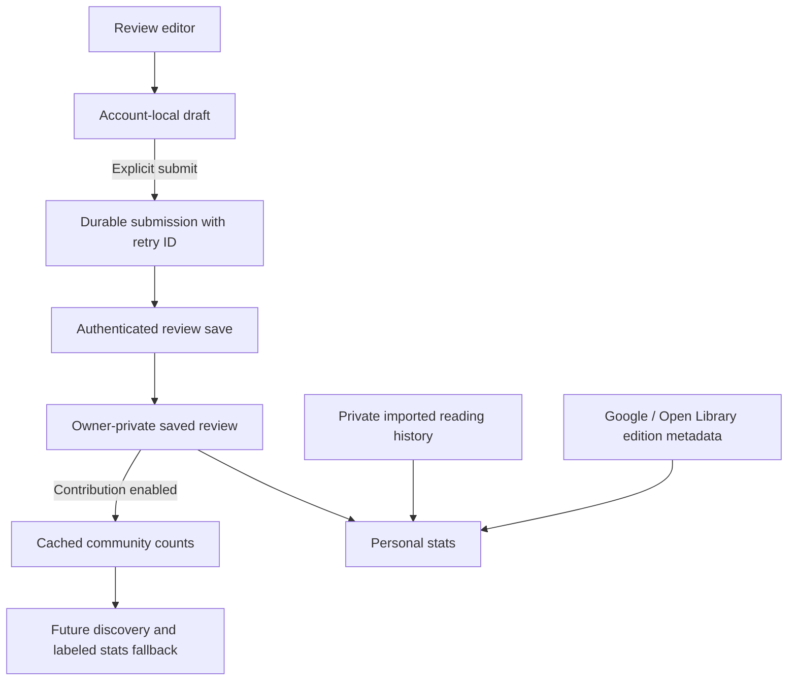

# Reviews and community discovery

Status: private review creation, editing, book-detail display, and My reviews are
implemented and locally tested. With explicit user approval on October 12, 2026,
migrations 007/008 were applied together in one transaction to the production Textual
Supabase project. Live checks verified all six review tables have RLS enabled,
the save/read endpoints exist, authenticated saves are granted, anonymous saves
are denied, and review reads are restricted to the owning account.
The public review feed and discovery UI remain future work.
No imported review, reading history, or existing account data is automatically shared.

## Data ownership and flow

Use the existing Supabase project and per-account SwiftData container. No new
backend vendor, vector database, or AI classification service is required.

- **Book identity:** `textual_books` remains the provider identity. New work/link
  tables group verified editions/provider records under one review work. Existing
  and newly saved catalog records initially get separate work identities. This is
  deliberately conservative; matching by title alone is not safe. The server-only
  merge function supports later verified links, preserving one latest assessment
  per reader and retaining moderation exclusions. Automated identity resolution is
  not implemented yet. Until a verified merge, different provider records remain
  separate communities.
- **Private reading activity:** existing library/import records retain statuses,
  dated reading periods, rereads, format and edition information. These are not
  duplicated in community reviews. Each new reading session should have its own
  stable event ID when the reading-log flow is introduced. Community reviews must
  never manufacture reading dates, read counts, page counts, or completion time.
- **Review draft:** `ReaderReviewDraft` is stored only in the active account's local
  database. Closing an editor or restarting the app preserves it. Draft changes
  do not publish or contribute. A frozen pending submission is separate from the
  editable draft so later edits cannot accidentally ride along with a retry.
- **Saved review:** one row per account/work, including an edition/provider reference,
  optional quarter-star rating, text, spoiler flag, optional mood and pace choices,
  text visibility, and a separate contribution switch. Default visibility is
  private and contribution is off. The server derives ownership from the session,
  validates choices against a controlled taxonomy, and rejects unknown fields.
  Public text visibility is a stored intent only in this foundation: there is no
  public text-reading endpoint or feed yet.
- **Community summaries:** contain counts only, one vote per reader/work. Each field
  has its own respondent count. Missing answers are not votes and rereads do not
  give extra weight. Mood selections can overlap, so their percentages need
  not total 100%. A field is withheld until at least five readers have contributed
  that field. This is a product threshold, not a claim of formal anonymization.

## Structured choices and stats

Moods are multiple choice; pace is single choice. Genres and fiction/nonfiction are
public catalog metadata and are not requested in reviews.
All fields are optional. Rating is an integer from 0 to 20 in quarter-star units;
null is different from zero. Taxonomy slugs are stable IDs; display labels are
retrieved separately from `textual_review_terms`. The public-catalog layer normalizes genre subjects using the same taxonomy as
Archive and Stats.

`ReviewStatsResolver` implements this precedence for mood and pace only:

1. The reader's saved or explicitly submitted assessment.
2. Their imported assessment where available.
3. Eligible community assessment, retaining `.community` provenance.
4. Unknown if none provides usable evidence.

Genres and fiction/nonfiction use public catalogs exclusively. Google results with
only broad classifications continue through verified title/author and Open Library
work lookups; source boundaries are retained so arbitrary subjects are not treated
as genres. Incomplete caches retry with backoff, including a one-time versioned
refresh for existing users. Review votes cannot override public classifications.

Pace community inference needs at least five respondents and an untied
60% majority. Mood inference retains labels chosen by at least three readers
and 40% of respondents. These are initial tunable product rules, not objective
truth. Discovery should display the underlying distribution and sample size.
The resolver is ready for the review flow but is **not wired into current charts**;
that integration needs the forthcoming editor/submission UI and summary loading.
Raw editor drafts must never change published/community stats.

## Database and performance

Migrations `007_reader_reviews.sql` and `008_catalog_owned_classification.sql` add work/link tables, controlled terms, reviews,
a retry ledger, summary storage, and these authenticated RPCs:

- `textual_read_own_review(expected_user_id, book_id)`
- `textual_save_review(expected_user_id, operation_id, book_id, expected_revision, content, deleted)`
- `textual_read_review_summary(book_id)`

Work identity merging is restricted to the trusted backend via
`textual_merge_review_works(source, target)`. Never place a service-role credential
in the iOS app. Verified merge updates revisions, so stale submissions must resolve
conflicts instead of overwriting another edition's latest assessment.

Reads fetch a small precomputed summary instead of every review. Inserts, edits,
withdrawals, moderation changes, and account deletion refresh the affected work's
summary transactionally. Indexed work lookups and a work-level lock prevent lost
updates when multiple readers contribute. This first implementation recomputes one
work's tally on writes: straightforward and correct for launch. If very popular
books develop high write contention, replace the refresh implementation with
incremental counters or a coalescing worker while preserving the RPC contract.
Add a bounded batch summary endpoint when loading community data across an entire
library; do not create an unbounded request per book on every stats visit.

Every new table has RLS and explicit client grants. Raw reviews are owner-only,
summary storage and retry ledgers are not directly exposed, and clients cannot
write work links, moderator flags, or aggregate counts. SQL functions have an empty
search path and explicitly scoped execution grants, following Supabase's
[RLS guidance](https://supabase.com/docs/guides/database/postgres/row-level-security)
and [function security guidance](https://supabase.com/docs/guides/database/functions).

The retry ledger deliberately retains payloads to make ambiguous network outcomes
idempotent. Review withdrawal removes the live contribution but is not permanent
personal-data erasure; account deletion cascades reviews and ledger entries.
Define retention/erasure and retry-expiry policy before public launch. Individual
review text removal from retained operation history needs that protocol, not an
unsafe blanket ledger purge.

## App integration

`AccountLibraryStore.reviews` owns the account-scoped `ReaderReviewStore` and stops
it on account dismissal. Network operations use `SupabaseReaderReviewTransport`.

- `BookReviewSection(book:)` is the reusable entry point on book detail. It resolves
  an existing local catalog record; adding an unsaved book requires the explicit
  “Add to archive & review” action. Catalog averages remain separate from your rating.
- `ReaderReviewEditor` and its observable model handle creation and editing. Rating
  and prose are independently optional; an empty assessment cannot be submitted.
  `RatingPicker` supports 0–5 stars in quarter steps; clearing means unrated, not zero.
  Spoilers are hidden by default when displaying review text.
- Draft edits save locally as they are made. Save freezes an explicit submission;
  closing the editor keeps the draft. Book detail and My reviews show saved/queued
  content, label unfinished changes, and never present an unfinished draft as saved.
- The editor checks the server revision before a first submission, surfaces conflicts
  with both versions, and keeps a failed submission queued with its original retry ID.
  Reopening or refreshing a clean review adopts newer remote data; unsubmitted edits
  are preserved, and stale downloads cannot regress acknowledged revisions.
- `AccountLibraryHost` provides the account-scoped store and repository through the
  environment. Library sync retries the review outbox on reconnect and foreground.
- My Archive → My reviews lists the reader's ratings, reviews, and unfinished drafts,
  with book/author search and the same editor. A paginated owner-only table read
  restores reviews on another device; all displayed records come from SwiftData.
- Removing a review queues a versioned withdrawal. It does not remove the book or
  private imported reading history. Reviews remain private and contributions off
  by default; this editor does not expose public sharing or structured mood/pace input.
- Imported ratings and Review text are displayed and prefilled without a submission.
  Native saves and withdrawals take precedence. Deliberately cleared drafts stay cleared.
  Review values do not change reading dates, reading statuses, or imported records.
  Chart integration and a public feed remain separate work.

Before a public review feed or automated discovery launch, add a safe public
projection, reporting/moderation workflow, contribution abuse/rate controls,
verified edition matching, cache freshness policy, and discovery ranking. The
`excluded` moderation flag and server aggregate refresh already support removing
contributions. Five accounts is a minimum sample size, not spam protection.

## Validation and deployment

`ReaderReviewTests` covers private defaults, local drafts, immutable retries, lost
responses, conflicts, and account switches. `ReviewStatsResolverTests` covers
provenance, field-level fallback, and insufficient/mixed community results.

`supabase/tests/reviews.test.mjs` runs migrations 001, 004, 007, and 008 in disposable
in-memory PostgreSQL using `@electric-sql/pglite`; it never connects to a backend.
Install the test dependency in a scratch directory or set `PGLITE_MODULE` to an
existing module entry, then run the script with Node. It verifies owner isolation,
authentication, validation, retry/CAS behavior, per-field thresholds, duplicate
edition votes, opt-out, withdrawal, moderation, account deletion, and trusted
work merging. Real multi-session load/concurrency and live Supabase integration
checks beyond schema/access verification remain outstanding; the in-memory test is not a load test.

Production deployment of 007 and 008 is complete. Do not rerun these migrations;
they are not repeatable setup scripts. The API schema cache was refreshed after
commit, and the public client correctly receives permission denied for anonymous
review-table access. Existing stats and import behavior remain unchanged.
