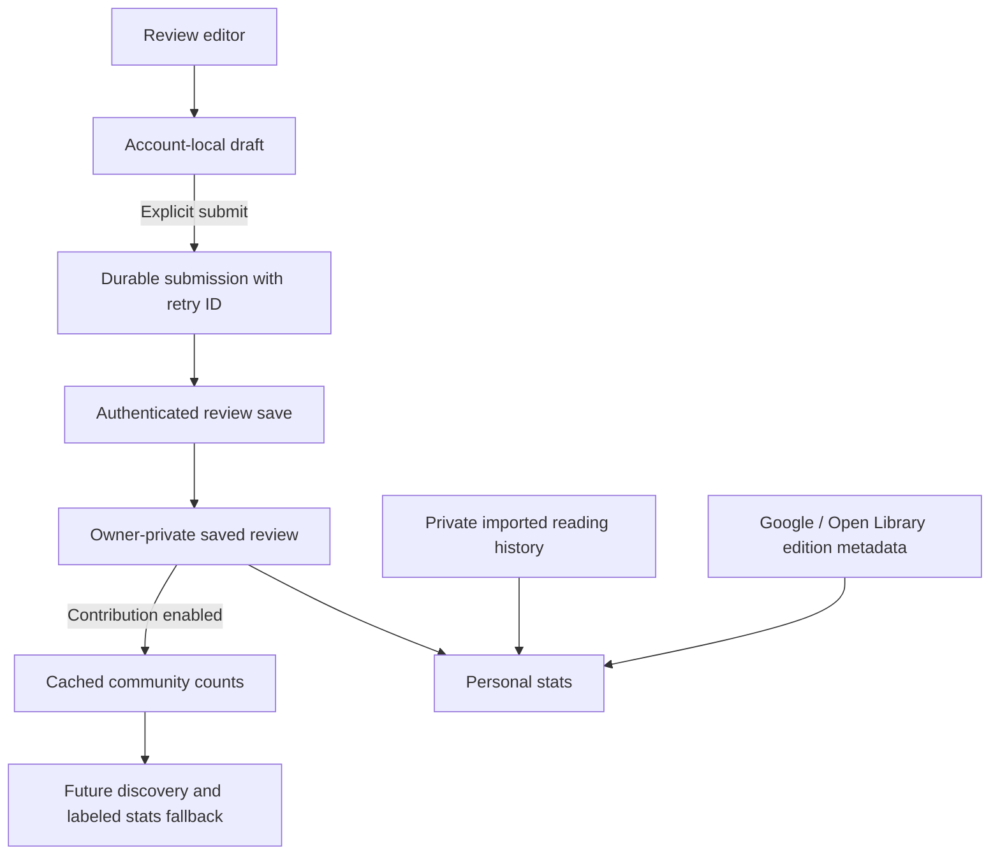

# Reviews and community discovery

Status: foundation implemented and locally tested; migration 007 is **not deployed**.
The review editor, public review feed, and discovery UI are the next feature work.
No imported review, reading history, or existing account data is automatically shared.

## Data ownership and flow

Use the existing Supabase project and per-account SwiftData container. No new
backend vendor, vector database, or AI classification service is required.

- **Book identity:** `textual_books` remains the provider identity. New work/link
  tables group verified editions/provider records under one review work. Existing
  and newly saved catalog records initially get separate work identities. This is
  deliberately conservative; matching by title alone is not safe. The server-only
  merge function supports later verified links, preserving one latest assessment
  per reader and retaining moderation exclusions. Automated identity resolution is
  not implemented yet. Until a verified merge, different provider records remain
  separate communities.
- **Private reading activity:** existing library/import records retain statuses,
  dated reading periods, rereads, format and edition information. These are not
  duplicated in community reviews. Each new reading session should have its own
  stable event ID when the reading-log flow is introduced. Community reviews must
  never manufacture reading dates, read counts, page counts, or completion time.
- **Review draft:** `ReaderReviewDraft` is stored only in the active account's local
  database. Closing an editor or restarting the app preserves it. Draft changes
  do not publish or contribute. A frozen pending submission is separate from the
  editable draft so later edits cannot accidentally ride along with a retry.
- **Saved review:** one row per account/work, including an edition/provider reference,
  optional quarter-star rating, text, spoiler flag, optional structured choices,
  text visibility, and a separate contribution switch. Default visibility is
  private and contribution is off. The server derives ownership from the session,
  validates choices against a controlled taxonomy, and rejects unknown fields.
  Public text visibility is a stored intent only in this foundation: there is no
  public text-reading endpoint or feed yet.
- **Community summaries:** contain counts only, one vote per reader/work. Each field
  has its own respondent count. Missing answers are not votes and rereads do not
  give extra weight. Mood/genre selections can overlap, so their percentages need
  not total 100%. A field is withheld until at least five readers have contributed
  that field. This is a product threshold, not a claim of formal anonymization.

## Structured choices and stats

Moods and genres are multiple choice; pace and fiction/nonfiction are single choice.
All fields are optional. Rating is an integer from 0 to 20 in quarter-star units;
null is different from zero. Taxonomy slugs are stable IDs; display labels are
retrieved separately from `textual_review_terms`. Free-form genre suggestions,
if introduced, need a moderation/alias path rather than fragmenting the taxonomy.

`ReviewStatsResolver` implements field-by-field precedence:

1. The reader's saved or explicitly submitted assessment.
2. Their imported assessment where available.
3. Eligible community assessment, retaining `.community` provenance.
4. Catalog data for genres and fiction/nonfiction.
5. Unknown if none provides usable evidence.

Pace/fiction community inference needs at least five respondents and an untied
60% majority. Mood/genre inference retains labels chosen by at least three readers
and 40% of respondents. These are initial tunable product rules, not objective
truth. Discovery should display the underlying distribution and sample size.
The resolver is ready for the review flow but is **not wired into current charts**;
that integration needs the forthcoming editor/submission UI and summary loading.
Raw editor drafts must never change published/community stats.

## Database and performance

Migration `007_reader_reviews.sql` adds work/link tables, controlled terms, reviews,
a retry ledger, summary storage, and these authenticated RPCs:

- `textual_read_own_review(expected_user_id, book_id)`
- `textual_save_review(expected_user_id, operation_id, book_id, expected_revision, content, deleted)`
- `textual_read_review_summary(book_id)`

Work identity merging is restricted to the trusted backend via
`textual_merge_review_works(source, target)`. Never place a service-role credential
in the iOS app. Verified merge updates revisions, so stale submissions must resolve
conflicts instead of overwriting another edition's latest assessment.

Reads fetch a small precomputed summary instead of every review. Inserts, edits,
withdrawals, moderation changes, and account deletion refresh the affected work's
summary transactionally. Indexed work lookups and a work-level lock prevent lost
updates when multiple readers contribute. This first implementation recomputes one
work's tally on writes: straightforward and correct for launch. If very popular
books develop high write contention, replace the refresh implementation with
incremental counters or a coalescing worker while preserving the RPC contract.
Add a bounded batch summary endpoint when loading community data across an entire
library; do not create an unbounded request per book on every stats visit.

Every new table has RLS and explicit client grants. Raw reviews are owner-only,
summary storage and retry ledgers are not directly exposed, and clients cannot
write work links, moderator flags, or aggregate counts. SQL functions have an empty
search path and explicitly scoped execution grants, following Supabase's
[RLS guidance](https://supabase.com/docs/guides/database/postgres/row-level-security)
and [function security guidance](https://supabase.com/docs/guides/database/functions).

The retry ledger deliberately retains payloads to make ambiguous network outcomes
idempotent. Review withdrawal removes the live contribution but is not permanent
personal-data erasure; account deletion cascades reviews and ledger entries.
Define retention/erasure and retry-expiry policy before public launch. Individual
review text removal from retained operation history needs that protocol, not an
unsafe blanket ledger purge.

## App integration contract for the next review flow

`AccountLibraryStore.reviews` owns the account-scoped `ReaderReviewStore` and stops
it on account dismissal. Network operations use `SupabaseReaderReviewTransport`.

1. Sync the library entry to obtain its server catalog ID.
2. Open the editor, load the own-review snapshot with `loadRemote(for:)`, and load
   taxonomy choices. `saveDraft(_:for:)` works offline even before that first read.
3. Show optional review choices, spoiler controls, text visibility, and a distinct
   contribution setting. Imported reviews must remain private unless explicitly
   submitted by the reader.
4. On the user's Save/Submit action call `queueSubmission(for:)`, then `flush()`.
   Reuse the frozen operation on retry. The editor must distinguish saved locally,
   queued, saved remotely, and conflict states without losing input.
5. Call `flush()` on reconnect/foreground once the flow can create pending work;
   lifecycle retry scheduling is not wired yet. It must run after library sync.
6. Resolve conflicts with `resolveConflict(for:keepLocal:)`; a new submission is
   explicit and gets a new retry ID. Do not silently overwrite another device.
7. Feed saved/queued personal choices and eligible community summaries to the stats
   resolver, preserving source labels. Keep filter scope and reread weighting in
   the existing stats layer. A community vote counts once even if the personal
   library counts multiple reads.
8. A review withdrawal queues a tombstone with empty content. Deleting a library
   entry is a separate action and does not implicitly delete a review. An owner
   can still withdraw an existing review after removing its library entry;
   creating or updating a live review requires an active synced library entry.

Before a public review feed or automated discovery launch, add a safe public
projection, reporting/moderation workflow, contribution abuse/rate controls,
verified edition matching, cache freshness policy, and discovery ranking. The
`excluded` moderation flag and server aggregate refresh already support removing
contributions. Five accounts is a minimum sample size, not spam protection.

## Validation and deployment

`ReaderReviewTests` covers private defaults, local drafts, immutable retries, lost
responses, conflicts, and account switches. `ReviewStatsResolverTests` covers
provenance, field-level fallback, and insufficient/mixed community results.

`supabase/tests/reviews.test.mjs` runs migrations 001, 004, and 007 in disposable
in-memory PostgreSQL using `@electric-sql/pglite`; it never connects to a backend.
Install the test dependency in a scratch directory or set `PGLITE_MODULE` to an
existing module entry, then run the script with Node. It verifies owner isolation,
authentication, validation, retry/CAS behavior, per-field thresholds, duplicate
edition votes, opt-out, withdrawal, moderation, account deletion, and trusted
work merging. Real multi-session load/concurrency and live Supabase integration
checks remain deployment gates; the in-memory test is not a load test.

Apply 007 through the project's controlled migration process after reviewing it
against the deployed schema. It is not a repeatable setup script. The app does not
call the new review endpoints until the next flow is connected, so existing stats
and import behavior remain unchanged by this foundation.
